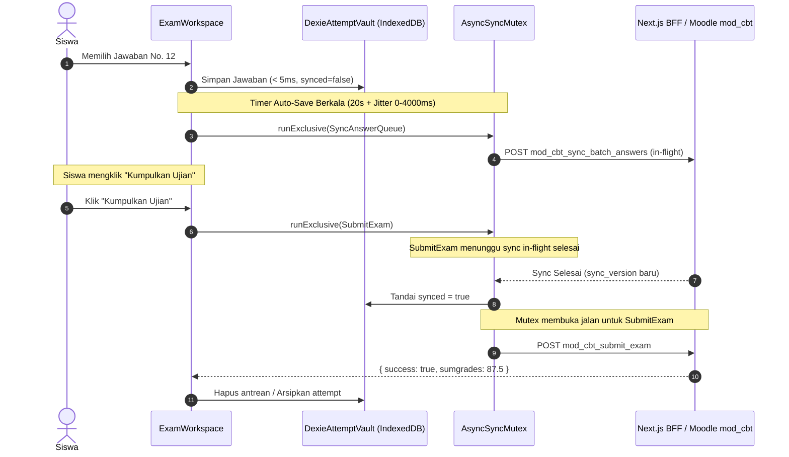

# 🎨 API Contract, State & Data Design: `aksaventra-cbt` (Next.js 16 + Moodle mod_cbt)

Dokumen ini mendefinisikan kontrak data, state klien, dan arsitektur integrasi antara frontend **Aksaventra CBT** (Next.js 16) dengan backend Moodle **`mod_cbt`** (`D:\Project\moodle_installer\moodle\mod\cbt`).

---

## 1. Definisi Tipe Domain Inti (`src/core/domain/entities/ExamTypes.ts`)

```typescript
/**
 * Tipe soal yang didukung oleh engine Moodle mod_cbt (score_calculator.php)
 */
export type QuestionType =
  | 'multichoice_single' // Pilihan ganda tunggal (A, B, C, D, E)
  | 'multichoice_multi'  // Pilihan ganda kompleks (array kunci, misal: ['A', 'C'])
  | 'match'              // Menjodohkan (pasangan subq -> match)
  | 'shortanswer'        // Isian singkat teks
  | 'truefalse'          // Benar / Salah (boolean atau string normalisasi)
  | 'essay';             // Esai / Uraian (penilaian manual)

/**
 * Status sesi pengerjaan ujian (exam_attempt.php)
 */
export type AttemptStatus = 'inprogress' | 'locked' | 'submitted' | 'abandoned';

/**
 * Tipe pelanggaran keamanan & intervensi pengawas (strike_policy.php)
 */
export type ViolationEventType =
  | 'TAB_BLUR'           // Pindah tab atau kehilangan fokus window (> grace period 2.5s)
  | 'FULLSCREEN_EXIT'    // Keluar dari mode fullscreen
  | 'DEVTOOLS_OPEN'      // Membuka developer tools / inspect element (immediate lockdown)
  | 'PROCTOR_UNLOCK'     // Aksi pengawas: buka blokir ujian
  | 'TIME_EXTEND'        // Aksi pengawas: penambahan waktu ujian
  | 'FORCE_SUBMIT';      // Aksi pengawas: kumpulkan paksa ujian

export interface QuestionOption {
  key: string;           // Identifikator opsi ('A', 'B', 'C', dll.)
  html: string;          // Konten HTML opsi (termasuk rumus KaTeX $$...$$)
}

export interface ExamQuestionItem {
  slot: number;          // Nomor urut tampilan soal bagi siswa (1, 2, 3...)
  questionId: number;    // ID unik butir soal dari Bank Soal Moodle
  type: QuestionType;    // Tipe soal
  stemHtml: string;      // Teks pertanyaan / narasi stimulus (HTML)
  options?: QuestionOption[]; // Daftar pilihan opsi (opsional untuk essay / shortanswer)
}

/**
 * Representasi jawaban lokal di IndexedDB (DexieAttemptVault)
 */
export interface LocalAnswerRecord {
  questionId: number;
  answer: string | string[] | Record<string, string> | boolean | null;
  flagged: boolean;      // Status ragu-ragu
  updatedAt: number;     // Timestamp perubahan lokal (epoch ms)
  synced: boolean;       // Status apakah sudah terkonfirmasi sinkron ke Moodle
}

/**
 * Payload sinkronisasi jawaban yang dikirim ke Moodle (sync_batch_answers.php)
 */
export interface MoodleAnswerBatchPayload {
  [questionId: string]: {
    ans: string | string[] | Record<string, string> | boolean | null;
    flag: boolean;
    ts: number;          // Timestamp dalam detik atau milidetik
  };
}
```

---

## 2. Kontrak DTO Web Service Moodle (`mod_cbt_*`)

### A. Manifest Ujian (`mod_cbt_get_exam_manifest`)
Endpoint pembuka saat siswa masuk dari ruang lobi. Mengembalikan metadata ujian dan seluruh butir naskah soal tanpa kunci jawaban (*stripped snapshot*).

```typescript
export interface GetExamManifestResponse {
  examId: number;
  title: string;
  durationSeconds: number;
  maxStrikes: number;
  serverTimestamp: number;
  attempt: {
    attemptId: number;
    timeStart: number;
    extraTimeSeconds: number;
    remainingSeconds: number;
    strikeCount: number;
    status: AttemptStatus;
    syncVersion: number;
  };
  questions: ExamQuestionItem[];
}
```

### B. Sinkronisasi Antrean Jawaban (`mod_cbt_sync_batch_answers`)
Pengiriman berkala berkas jawaban siswa dengan mekanisme *Optimistic Locking* via `sync_version`.

```typescript
export interface SyncBatchAnswersRequest {
  attemptid: number;
  sync_version: number;
  answers_json: string; // JSON.stringify(MoodleAnswerBatchPayload)
}

export interface SyncBatchAnswersResponse {
  success: boolean;
  sync_version: number;
  server_time: number;
  remaining_seconds: number;
  status: AttemptStatus;
  error?: string;
}
```

### C. Laporan Pelanggaran Keamanan (`mod_cbt_report_violation`)
```typescript
export interface ReportViolationRequest {
  attemptid: number;
  event_type: 'TAB_BLUR' | 'FULLSCREEN_EXIT' | 'DEVTOOLS_OPEN';
  details?: string;     // JSON string konteks browser
}

export interface ReportViolationResponse {
  strike_count: number;
  locked: boolean;
  status: AttemptStatus;
  message: string;
}
```

### D. Finalisasi & Pengumpulan Ujian (`mod_cbt_submit_exam`)
```typescript
export interface SubmitExamRequest {
  attemptid: number;
}

export interface SubmitExamResponse {
  success: boolean;
  sumgrades: number;    // Nilai akhir kalkulasi in-memory
  timefinish: number;   // Timestamp penutupan sesi
}
```

### E. Ruang Kendali Pengawas (`mod_cbt_proctor_control`)
```typescript
export interface ProctorControlRequest {
  attemptid: number;
  action: 'unlock' | 'extend_time' | 'force_submit';
  payload?: string;     // JSON string, misal: { "seconds": 600, "reason": "Listrik padam" }
}

export interface ProctorControlResponse {
  success: boolean;
  message: string;
  attempt: {
    id: number;
    status: AttemptStatus;
    strike_count: number;
    extra_time: number;
    sumgrades?: number;
  };
}
```

---

## 3. Protokol Handshake Peluncuran dari Moodle (`launch.php`)

Saat siswa mengklik aktivitas CBT di dalam kursus Moodle, berkas `mod/cbt/launch.php` menghasilkan *one-time short-lived launch token* (berlaku 5 menit) dan mengarahkan browser ke Next.js:

```text
http://<nextjs_host>:3000/student/lobby/<cbtid>?cmid=<cmid>&launch_token=<token>&moodle_api=<encoded_url>
```

1. **Next.js `/api/auth/moodle-launch`:**
   - Memvalidasi `launch_token` dan mengambil sesi siswa dari cache Moodle.
   - Menghasilkan JWT sesi CBT Aksaventra (`CBT_JWT_SECRET`) dan menyimpan *cookie* aman HttpOnly.
2. **Halaman Lobi (`/student/lobby/[cbtId]`):**
   - Melakukan *pre-flight check*: status koneksi internet, ketersediaan IndexedDB, dan header Safe Exam Browser (SEB).
   - Meminta input Token Ruang 6-digit.

---

## 4. Algoritma Token Ruang 6-Digit (`token_generator.php`)

Sistem token ruang menggunakan algoritma deterministik berbasis HMAC-SHA256 yang selaras dengan implementasi PHP:
- **Alphabet Unambiguous:** `23456789ABCDEFGHJKLMNPQRSTUVWXYZ` (Base32, tanpa karakter rancu seperti 0, 1, I, O).
- **Time Window:** 900 detik (15 menit).
- **Formula:** `HMAC-SHA256(floor(timestamp / 900), tokensecret)` -> ekstraksi 6 karakter Base32.
- **Manual Override:** Pengawas dapat menyetel *active token* manual melalui dashboard proktor.

---

## 5. Arsitektur Mutex Barrier & Scheduler Jitter Klien


